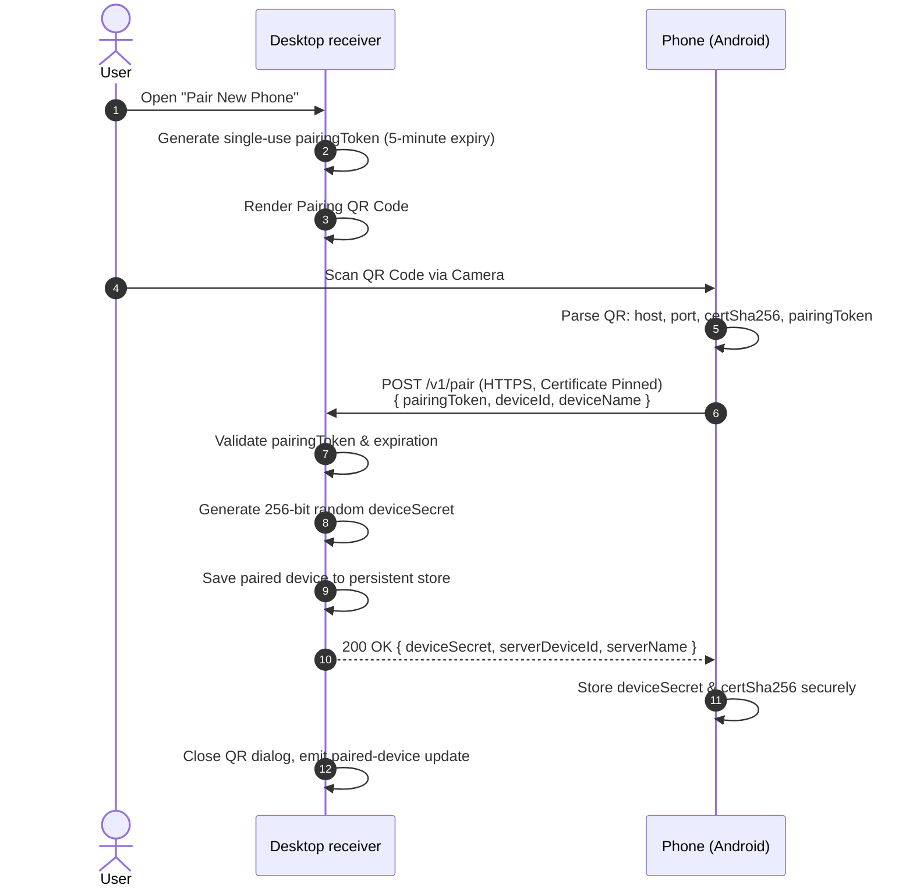

# FLIQON Protocol Specification (v1)

This specification defines the cryptographic pairing, discovery, authentication, and file transfer protocol for **FLIQON v1**.

---

## 1. Cryptographic Identity & Transport Security

### 1.1. Desktop Self-Signed TLS Certificate
On first launch, the desktop generates an X.509 certificate and private key:
- Key Type: ECDSA P-256 or RSA 2048-bit.
- Subject: `CN=FLIQON-Desktop-<device_id>`, `O=Fliqon Technologies`.
- Validity: 10 years.
- Storage: Stored securely in `%LOCALAPPDATA%\com.fliqon.app\certs\cert.pem` and `key.pem`.
- **Certificate Fingerprint**: SHA-256 hash of the DER-encoded certificate, represented as a 64-character lowercase hexadecimal string:
  $$\text{certSha256} = \text{SHA-256}(\text{DER}(\text{cert}))$$

### 1.2. Strict Certificate Pinning
All communication between Android and the Windows daemon is strictly **HTTPS**. The Android application pins the SHA-256 certificate fingerprint exchanged during pairing.
- If a server's TLS certificate does not match the pinned `certSha256`, the connection is immediately aborted.
- Cleartext HTTP is disabled (`android:usesCleartextTraffic="false"`).

---

## 2. Pairing Workflow



### 2.1. Pairing QR Code Schema
The QR code encodes a compact JSON string:
```json
{
  "v": 1,
  "name": "Windows-Laptop (Fliqon)",
  "host": "192.168.0.101",
  "port": 52400,
  "certSha256": "4a7f1b2c3d4e5f60718293a4b5c6d7e8f90123456789abcdef0123456789abcd",
  "pairingToken": "ptk_8f90b2c14a7e...",
  "expiresAt": 1794738500
}
```

### 2.2. Pairing Endpoint: `POST /v1/pair`
- **Request Body**:
  ```json
  {
    "pairingToken": "ptk_8f90b2c14a7e...",
    "deviceId": "fliqon-android-s24-xyz",
    "deviceName": "Samsung Galaxy S24",
    "platform": "android"
  }
  ```
- **Response `200 OK`**:
  ```json
  {
    "status": "paired",
    "deviceSecret": "a98f12c34d5e6f708192a3b4c5d6e7f8019283746554433221100ffeeddccbba",
    "serverDeviceId": "fliqon-win-abc12345",
    "serverName": "Windows-Laptop (Fliqon)"
  }
  ```
- **Error Responses**:
  - `400 Bad Request`: Missing fields or invalid JSON.
  - `401 Unauthorized`: Invalid or expired pairing token.
  - `409 Conflict`: Device already paired.

---

## 3. Request Authentication (HMAC-SHA256)

Every subsequent request from Android to the Desktop must be signed using the shared `deviceSecret`.

### 3.1. Authentication Headers

| Header | Description | Example |
| :--- | :--- | :--- |
| `X-Fliqon-Device-Id` | Unique ID of the sending device | `fliqon-android-s24-xyz` |
| `X-Fliqon-Timestamp` | Unix timestamp in seconds | `1794738120` |
| `X-Fliqon-Nonce` | Unique UUIDv4 or 16-byte random hex | `b1e2c3d4-e5f6-7890-abcd-1234567890ab` |
| `X-Fliqon-Signature` | Hex-encoded HMAC-SHA256 signature | `e3b0c44298fc1c149afbf4c8996fb924...` |

### 3.2. Canonical String & Signature Calculation
$$\text{CanonicalString} = \text{METHOD} + \text{"\n"} + \text{PATH} + \text{"\n"} + \text{TIMESTAMP} + \text{"\n"} + \text{NONCE} + \text{"\n"} + \text{BODY\_SHA256}$$

Where:
- `METHOD`: Uppercase HTTP method (e.g., `POST`, `GET`).
- `PATH`: Exact request URI path (e.g., `/v1/transfer/upload`).
- `TIMESTAMP`: String representation of the timestamp header.
- `NONCE`: String representation of the nonce header.
- `BODY_SHA256`: Lowercase hex SHA-256 of the payload body (or empty string SHA-256 `e3b0c44298fc1c149afbf4c8996fb92427ae41e4649b934ca495991b7852b855` for empty body).
- `SIGNATURE`: $\text{HMAC-SHA256}(\text{deviceSecret}, \text{CanonicalString})$

### 3.3. Replay & Clock Skew Validation
The server verifies:
1. Device ID exists in paired devices store and is not revoked.
2. Clock skew check: $|\text{server\_time} - \text{X-Fliqon-Timestamp}| \le 60\text{ seconds}$.
3. Nonce cache check: The server maintains an in-memory sliding window cache of seen nonces for the past 120 seconds. If `X-Fliqon-Nonce` has already been recorded, the request is rejected with `401 Unauthorized` ("Replay attack detected").
4. Computed HMAC matches `X-Fliqon-Signature`.

---

## 4. API Endpoints

### 4.1. Server Info: `GET /v1/info`
Authenticated via HMAC headers.
- **Response `200 OK`**:
  ```json
  {
    "name": "Windows-Laptop (Fliqon)",
    "appVersion": "1.0.0",
    "protocolVersion": 1,
    "maxFileSize": 4294967296,
    "freeSpaceBytes": 284920481792
  }
  ```

### 4.2. Direct File Upload: `POST /v1/transfer/upload`
Used for files smaller than 50 MB or single-shot transfers.
- **Headers**:
  - HMAC authentication headers (`X-Fliqon-*`)
  - `x-transfer-id`: Unique transfer UUIDv4
  - `x-batch-id`: Shared UUIDv4 for grouping multi-file flick selections
  - `x-filename`: UTF-8 sanitized filename
  - `x-file-size`: Total byte size
  - `x-expected-sha256`: SHA-256 checksum of the whole file
  - `Content-Type`: `application/octet-stream`
- **Body**: Binary raw stream of the file.
- **Server Validations**:
  1. HMAC signature verified.
  2. Free disk space verified ($\text{freeSpace} > \text{fileSize} \times 1.2$).
  3. File size capped at `maxFileSize` (currently 16 GB).
  4. Filename sanitized against path traversal and Windows reserved names.
  5. SHA-256 checksum calculated and verified upon completion.
- **Response `200 OK`**:
  ```json
  {
    "success": true,
    "transferId": "4a7f...",
    "batchId": "8b9e...",
    "filename": "document.pdf",
    "fileSize": 129175,
    "checksumSha256": "5c2e...",
    "savedPath": "C:\\Users\\...\\Downloads\\FLIQON\\document.pdf"
  }
  ```

### 4.3. Resumable Chunked Upload: `POST /v1/transfer/chunk`
Used for large files or unreliable connections.
- **Headers**:
  - HMAC authentication headers
  - `x-transfer-id`: UUIDv4
  - `x-batch-id`: UUIDv4
  - `x-chunk-index`: 0-based integer
  - `x-total-chunks`: Total number of chunks
  - `x-chunk-offset`: Byte offset of this chunk in the whole file
  - `x-chunk-size`: Size of this chunk in bytes
  - `x-total-size`: Total size of the complete file
  - `x-filename`: Sanitized filename
  - `x-chunk-sha256`: SHA-256 of this chunk's payload
- **Body**: Binary chunk payload.
- **Response `200 OK`**:
  ```json
  {
    "success": true,
    "transferId": "4a7f...",
    "chunkIndex": 3,
    "bytesReceived": 1048576,
    "isComplete": false
  }
  ```

### 4.4. Complete Resumable Upload: `POST /v1/transfer/complete`
Finalizes chunk reassembly and verifies overall file integrity.
- **Body**:
  ```json
  {
    "transferId": "4a7f...",
    "batchId": "8b9e...",
    "expectedSha256": "9f8e7d..."
  }
  ```

---

## 5. Receiver Safety Requirements

A conforming receiver MUST:

- treat every filename as untrusted: strip path separators, `..` sequences, control characters and characters illegal on the target filesystem, and refuse reserved device names;
- write files only inside its configured destination folder, creating new files atomically and never overwriting an existing file (e.g. `name (1).ext`);
- verify the SHA-256 of every completed file against the signed expected hash and discard mismatches;
- only accept `transferId` / `batchId` values made of `[A-Za-z0-9_-]` (max 64 chars).

## 6. Local Discovery (mDNS / DNS-SD)

- **Service Type**: `_fliqon._tcp.local.`
- **TXT Records**:
  - `id`: Desktop Device ID (`fliqon-win-xyz`)
  - `name`: User-friendly desktop hostname
  - `proto`: `1` (Protocol version)
  - `cert`: SHA-256 fingerprint prefix (first 16 hex chars)
- **Android Behavior**:
  Android resolves `_fliqon._tcp` via `NsdManager`. When a service is discovered:
  1. Checks if `id` matches a paired device in local Room database.
  2. If paired, connects via HTTPS to `https://<host>:<port>/v1/info`.
  3. Verifies full TLS cert SHA-256 fingerprint against the pinned fingerprint.

## 7. Protocol v1.1 Additions (backward compatible)

### 7.1. Body hash per route
`BODY_SHA256` in the canonical string is always the SHA-256 of the real payload:

| Route | BODY_SHA256 |
| --- | --- |
| `GET /v1/info` | SHA-256 of the empty string |
| `POST /v1/transfer/upload` | whole-file SHA-256 (must equal `x-expected-sha256`, which is now required) |
| `POST /v1/transfer/chunk` | SHA-256 of the chunk bytes |
| `POST /v1/transfer/complete`, `/announce`, `/v1/device/revoke` | SHA-256 of the raw JSON body |

The HMAC key is the UTF-8 bytes of the 64-char hex `deviceSecret` (what Android sends). The desktop also accepts the hex-decoded 32-byte key used by early builds.

### 7.2. `POST /v1/transfer/announce`
Sent the instant the user flicks, before any upload, so the desktop's spatial overlay can render every incoming card immediately. Best-effort; uploads never wait on it.
```json
{ "batchId": "uuid", "trigger": "physical_phone_flick",
  "files": [ { "transferId": "uuid", "filename": "IMG_1.jpg", "fileSize": 3400000 } ] }
```
Each later upload reuses the announced `x-transfer-id`.

### 7.3. Lossless filenames
`x-filename-utf8`: percent-encoded UTF-8 filename (spaces as `%20`). Preferred over the ASCII-only `x-filename`, which remains for older desktops.

### 7.4. Discovery
- mDNS `_fliqon._tcp` instance name = the desktop's **persistent** device id (stable across restarts).
- Every 3 s the desktop broadcasts a UDP datagram to port **52401**:
  `{"type":"FLIQON_DISCOVERY","id":"fliqon-win-…","name":"…","port":52400,"proto":1,"cert":"<16-hex prefix>"}`.
  Android uses the sender IP to follow the paired PC across DHCP changes.

---

This specification is licensed under the [Creative Commons Attribution 4.0 International licence (CC BY 4.0)](https://creativecommons.org/licenses/by/4.0/). It covers the protocol document only; the Fliqon applications are proprietary.
